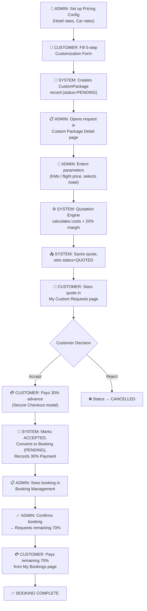
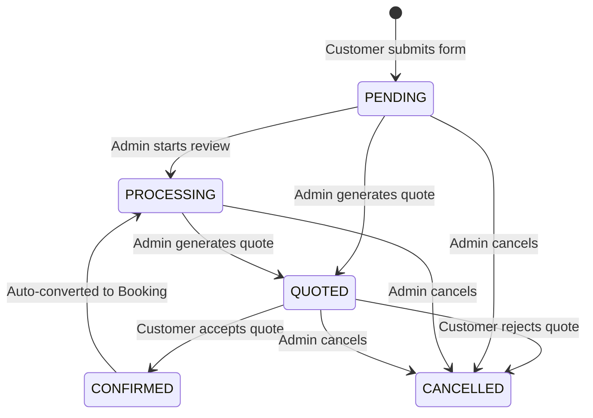

# Custom Tour Package & Quotation System — Complete Workflow

> **Full end-to-end documentation** of how the Customization → Pricing Config → Quotation → Payment pipeline works across the entire codebase.

---

## Table of Contents

1. [High-Level Flow Diagram](#1-high-level-flow-diagram)
2. [Phase 0 — Admin Pre-Setup (Pricing Configuration)](#2-phase-0--admin-pre-setup-pricing-configuration)
3. [Phase 1 — Customer Submits Custom Tour Request](#3-phase-1--customer-submits-custom-tour-request)
4. [Phase 2 — Admin Reviews & Generates Quotation](#4-phase-2--admin-reviews--generates-quotation)
5. [Phase 3 — Customer Reviews Quote & Pays 30% Advance](#5-phase-3--customer-reviews-quote--pays-30-advance)
6. [Phase 4 — Admin Confirms Booking & Requests Remaining 70%](#6-phase-4--admin-confirms-booking--requests-remaining-70)
7. [Calculation Engine — The Math](#7-calculation-engine--the-math)
8. [Complete File Map](#8-complete-file-map)
9. [API Endpoints Reference](#9-api-endpoints-reference)
10. [Database Models Reference](#10-database-models-reference)

---

## 1. High-Level Flow Diagram



---

## 2. Phase 0 — Admin Pre-Setup (Pricing Configuration)

> **Who does this?** Admin  
> **When?** Before any customer can get a quote — this is the master rate card.  
> **What page?** Admin Panel → `/admin/pricing-config`

### What the Admin Does

The admin opens the **Quotation Pricing Configuration** page, which has two tabs:

#### Tab 1: Hotel Rates
Admin creates entries for hotels with:
| Field | Example |
|-------|---------|
| `hotel_name` | Hotel Taj Palace |
| `location` | Goa |
| `hotel_tier` | 3-star, 4-star, 5-star, resort |
| `room_type` | single, double, triple |
| `price_per_night` | ₹2,500 |
| `is_active` | true/false |

#### Tab 2: Car Travel Rates
Admin creates entries for car pricing:
| Field | Example |
|-------|---------|
| `price_per_km` | ₹12.00 |
| `description` | AC Innova rate |
| `is_active` | true/false |

### Files Involved

| File | What it does |
|------|-------------|
| [PricingConfig.jsx](file:///c:/Users/Kushal/OneDrive/Desktop/tours_travels/frontend/src/Admin/QuotationPricing/PricingConfig.jsx) | Admin UI — two-tab interface for CRUD on hotel & car configs |
| [models.py](file:///c:/Users/Kushal/OneDrive/Desktop/tours_travels/backend/apps/tours/models.py#L734-L786) | `HotelPricingConfig` model (L734–L769) and `CarPricingConfig` model (L772–L786) |
| [serializers_quotation.py](file:///c:/Users/Kushal/OneDrive/Desktop/tours_travels/backend/apps/tours/serializers_quotation.py#L5-L16) | `HotelPricingConfigSerializer` and `CarPricingConfigSerializer` |
| [views_quotation.py](file:///c:/Users/Kushal/OneDrive/Desktop/tours_travels/backend/apps/tours/views_quotation.py#L21-L52) | `HotelPricingConfigViewSet` (admin CRUD) and `PublicHotelPricingConfigViewSet` (read-only for customers) |
| [admin.py](file:///c:/Users/Kushal/OneDrive/Desktop/tours_travels/backend/apps/tours/admin.py#L377-L388) | Django Admin registration for both models |
| [urls.py](file:///c:/Users/Kushal/OneDrive/Desktop/tours_travels/backend/apps/tours/urls.py#L34-L39) | Route registration for admin pricing endpoints |
| [ENDPOINTS.js](file:///c:/Users/Kushal/OneDrive/Desktop/tours_travels/frontend/src/constant/ENDPOINTS.js#L61-L75) | Frontend endpoint constants for hotel & car config APIs |

### API Endpoints Used

| Method | Endpoint | Purpose |
|--------|----------|---------|
| `GET` | `/api/v1/tours/admin/pricing/hotels/` | List all hotel configs |
| `POST` | `/api/v1/tours/admin/pricing/hotels/` | Create hotel config |
| `PUT` | `/api/v1/tours/admin/pricing/hotels/{id}/` | Update hotel config |
| `DELETE` | `/api/v1/tours/admin/pricing/hotels/{id}/` | Delete hotel config |
| `GET` | `/api/v1/tours/admin/pricing/cars/` | List all car configs |
| `POST` | `/api/v1/tours/admin/pricing/cars/` | Create car config |
| `PUT` | `/api/v1/tours/admin/pricing/cars/{id}/` | Update car config |
| `DELETE` | `/api/v1/tours/admin/pricing/cars/{id}/` | Delete car config |
| `GET` | `/api/v1/tours/public/hotel-options/` | Public read-only for customer page |

> [!IMPORTANT]
> These pricing configs are **independent** of the general Hotel model used for tour management. They are a separate `HotelPricingConfig` table specifically for the quotation engine.

---

## 3. Phase 1 — Customer Submits Custom Tour Request

> **Who does this?** Logged-in Customer  
> **What page?** Customer website → `/customize-tour`

### What the Customer Does

The customer fills a **5-step wizard form**:

| Step | Title | Fields Collected |
|------|-------|-----------------|
| **0** | Personal Details | First name, Last name, Email, Phone, Departure city, Number of travelers |
| **1** | Destinations & Stay | City/place, Stay duration (days), Check-in/out dates, Hotel preference (tier), Room type — **multiple destinations** supported |
| **2** | Activities & Preferences | Activity name, type, duration, preference level (must-have/preferred/optional), Meal preferences, Group composition |
| **3** | Travel Details | Start date, Number of people, Budget range, Tour type, Transportation mode (Car/Flight/Train/Bus) |
| **4** | Review | Summary of all data — customer clicks "Submit Request" |

### What the System Does on Submit

1. **Validates** all required fields (date must be tomorrow+, check-in must be after start date)
2. **Calculates** `total_nights` by summing stay durations across all destinations
3. **Derives** `hotel_preference` and `room_type` from the first destination that has them
4. **Sends** `POST /api/v1/tours/custom-packages/` with:

```json
{
  "customer_name_input": "John Doe",
  "customer_email_input": "john@email.com",
  "contact_number": "9876543210",
  "from_city": "Mumbai",
  "destination": "Goa, Manali",
  "duration": "5 days",
  "total_nights": 5,
  "start_date": "2026-05-01",
  "participants_count": 3,
  "hotel_preference": "4-star",
  "room_type": "double",
  "transportation_choice": "Flight",
  "package_type": "ADVENTURE",
  "budget_range": "50000-100000",
  "detailed_itinerary": "{\"destinations\":[...],\"activities\":[...],\"transportation_details\":{...}}"
}
```

5. **Backend creates** a `CustomPackage` record with `status='PENDING'`
6. **Customer is redirected** to `/my-custom-requests` to track the request

### Files Involved

| File | What it does |
|------|-------------|
| [Customization.jsx](file:///c:/Users/Kushal/OneDrive/Desktop/tours_travels/frontend/src/Customer/components/Customization.jsx) | Full 5-step wizard form (1544 lines). Handles destinations array, activities array, form validation, date checks |
| [views.py](file:///c:/Users/Kushal/OneDrive/Desktop/tours_travels/backend/apps/tours/views.py#L416-L468) | `CustomPackageViewSet.create()` — saves package, assigns `customer` from authenticated user |
| [serializers.py](file:///c:/Users/Kushal/OneDrive/Desktop/tours_travels/backend/apps/tours/serializers.py#L770-L891) | `CustomPackageSerializer` — validates start_date (future), budget_range, traveler_details, cross-validates start_date vs check-in dates |
| [models.py](file:///c:/Users/Kushal/OneDrive/Desktop/tours_travels/backend/apps/tours/models.py#L789-L947) | `CustomPackage` model — all fields from customer input + admin quotation fields |
| [route.js](file:///c:/Users/Kushal/OneDrive/Desktop/tours_travels/frontend/src/constant/route.js#L321-L327) | Route config: `/customize-tour` → `Customization` component |

### Key Validations (Backend Serializer)

- `start_date` must be in the future
- `budget_range` must be from the allowed choices list
- If `detailed_itinerary` has check-in dates, `start_date` must be ≤ earliest check-in
- `traveler_details` must be a list of objects with `name` and `age`

---

## 4. Phase 2 — Admin Reviews & Generates Quotation

> **Who does this?** Admin  
> **What page?** Admin Panel → `/admin/custom-packages` → click **View** → `/admin/custom-packages/{id}`

### Step 1: Admin Opens Custom Packages List

The admin sees a table of all custom requests with columns: Request ID, Customer, Destination, Details (duration + people), Type, Status, Created date, and Actions.

**Filtering:** Admin can search by customer name/email/destination and filter by status (Pending, Processing, Quoted, Confirmed, Cancelled).

### Step 2: Admin Opens Request Detail Page

The detail page is split into **two panels**:

#### Left Panel — User Request Details (read-only)
Shows: Customer info, From City, Destination, Duration (Nights), Start Date, Participants, Transport type, Hotel Preference, Room Preference, Budget, Special Requirements.

#### Right Panel — Quotation Engine (interactive form)

The admin fills in **operational parameters**:

| Customer Transport | Admin Inputs |
|-------------------|-------------|
| **Car** | Select Car Rate (from dropdown of active `CarPricingConfig`), Estimated KMs Distance |
| **Flight / Train** | Direct Travel Cost per person (₹) |

| Hotel Needed? | Admin Inputs |
|---------------|-------------|
| **Yes** (nights > 0) | Customer preferences are shown read-only. Admin selects a specific hotel from the `HotelPricingConfig` dropdown (filtered by location & tier match) |

Admin can also write a **message to customer** that gets sent with the quote.

### Step 3: Admin Clicks "Calculate & Generate Quote"

**Frontend sends** `POST /api/v1/tours/admin/custom-packages/{id}/enter-parameters/`

```json
{
  "admin_kms_distance": 500,          // if Car
  "admin_direct_travel_price": 8000,  // if Flight/Train
  "admin_selected_car_config": "uuid", // if Car
  "admin_selected_hotel": "uuid",      // Hotel from HotelPricingConfig
  "admin_confirmed_hotel_tier": "4-star", // Auto-injected from customer preference
  "admin_confirmed_room_type": "double",  // Auto-injected from customer preference
  "admin_response": "Dear customer, here is your quote..."
}
```

### What the System Does (Quotation Engine)

> See [Section 7](#7-calculation-engine--the-math) for the full formula.

1. **Validates** admin inputs via `AdminEnterParametersSerializer`
2. **Calculates** travel cost, hotel cost, base cost, margin, final price
3. **Saves** all costs to the `CustomPackage` record
4. **Builds** a detailed `quotation_breakdown` JSON
5. **Sets** `status = 'QUOTED'` and `quotation_generated_at = now()`
6. **Returns** breakdown + final price to the frontend

### Files Involved

| File | What it does |
|------|-------------|
| [List.jsx](file:///c:/Users/Kushal/OneDrive/Desktop/tours_travels/frontend/src/Admin/CustomPackages/List.jsx) | Admin list page showing all custom package requests with search, filter, and action buttons |
| [CustomRequestDetail.jsx](file:///c:/Users/Kushal/OneDrive/Desktop/tours_travels/frontend/src/Admin/CustomPackages/CustomRequestDetail.jsx) | Admin detail page with two-panel layout: customer info (left) + quotation engine form (right). Shows quotation breakdown after generation |
| [views_quotation.py](file:///c:/Users/Kushal/OneDrive/Desktop/tours_travels/backend/apps/tours/views_quotation.py#L55-L230) | `AdminCustomPackageViewSet` with `enter_parameters()` action — **the core calculation engine** |
| [serializers_quotation.py](file:///c:/Users/Kushal/OneDrive/Desktop/tours_travels/backend/apps/tours/serializers_quotation.py#L19-L49) | `AdminEnterParametersSerializer` — validates KMs (required for car), direct price (required for flight/train), hotel tier/room must be paired |
| [route.js](file:///c:/Users/Kushal/OneDrive/Desktop/tours_travels/frontend/src/constant/route.js#L134-L157) | Routes: `/admin/custom-packages` (list) and `/admin/custom-packages/:id` (detail) |

### Quotation Breakdown JSON (stored in DB)

```json
{
  "transportation": {
    "type": "flight",
    "kms_distance": null,
    "direct_price_per_person": 8000.0,
    "price_per_km": null,
    "travel_cost_per_person": 8000.0,
    "total_travel_cost": 24000.0
  },
  "accommodation": {
    "hotel_tier": "4-star",
    "room_type": "double",
    "price_per_night": 2500.0,
    "nights": 5,
    "participants": 3,
    "rooms_needed": 0,
    "hotel_cost_per_person": 12500.0,
    "total_hotel_cost": 37500.0,
    "selected_hotel_id": "uuid-here",
    "selected_hotel_name": "Hotel Taj Palace"
  },
  "summary": {
    "base_cost_per_person": 20500.0,
    "participants": 3,
    "total_base_cost": 61500.0,
    "margin_20_percent": 12300.0,
    "final_quoted_price": 73800.0
  }
}
```

---

## 5. Phase 3 — Customer Reviews Quote & Pays 30% Advance

> **Who does this?** Customer  
> **What page?** Customer website → `/my-custom-requests`

### What the Customer Sees

1. A **table** of all their custom requests showing: Request ID, Destinations, Duration, Budget, Status, Quoted Price, Customer Response, Actions
2. Customer clicks **View Details** → opens a modal with:
   - **Status Timeline** (visual progress: Submitted → Under Review → Quoted → Customer Response → Confirmed)
   - **Basic Information** (destinations, dates, travelers, budget, transport, hotel)
   - **Detailed Preferences** (parsed from `detailed_itinerary` JSON)
   - **Admin Response** card with the quoted price and message

### Customer Decision

#### Option A: Accept & Pay 30% Advance

Customer clicks **"Accept & Pay 30% Advance"** → Opens **Secure Checkout Modal** with:
- Quote Summary showing: Base price, GST (5%), Total, Required Advance (30%)
- Credit card form (card number, expiry, CVV, cardholder name)
- SSL/PCI compliance badges

**On payment submit, frontend does 3 API calls in sequence:**

```
1. POST /api/v1/tours/custom-packages/{id}/customer_response/
   Body: { "response": "ACCEPTED" }
   → Sets customer_response='ACCEPTED', status='CONFIRMED'

2. POST /api/v1/tours/custom-packages/{id}/convert_to_booking/
   Body: {}
   → Creates Booking (PENDING), creates Invoice (DRAFT)
   → Returns: { booking_id, total_amount }

3. POST /api/v1/payments/
   Body: { booking: booking_id, amount: total_amount * 0.3, payment_method: "CREDIT_CARD", status: "SUCCESS" }
   → Records the 30% advance payment
```

Customer is then **redirected to `/my-bookings`** to see their new PENDING booking.

#### Option B: Reject Quote

Customer clicks **"Reject Quote"** → Confirmation popup → 
```
POST /api/v1/tours/custom-packages/{id}/customer_response/
Body: { "response": "REJECTED" }
→ Sets customer_response='REJECTED', status='CANCELLED'
```

### Files Involved

| File | What it does |
|------|-------------|
| [MyCustomRequests.jsx](file:///c:/Users/Kushal/OneDrive/Desktop/tours_travels/frontend/src/Customer/components/MyCustomRequests.jsx) | Customer's "My Custom Requests" page — table + detail modal + payment modal. Handles accept/reject flow and 3-step payment process |
| [views.py](file:///c:/Users/Kushal/OneDrive/Desktop/tours_travels/backend/apps/tours/views.py#L470-L527) | `customer_response()` action — validates quote exists, response not already given, saves ACCEPTED/REJECTED |
| [views.py](file:///c:/Users/Kushal/OneDrive/Desktop/tours_travels/backend/apps/tours/views.py#L529-L627) | `convert_to_booking()` action — creates `Booking` (PENDING), creates `Invoice` (DRAFT) with GST calculation |
| [views.py](file:///c:/Users/Kushal/OneDrive/Desktop/tours_travels/backend/apps/payments/views.py#L16-L79) | `PaymentViewSet.create()` — records payment, auto-syncs invoice status |
| [models.py](file:///c:/Users/Kushal/OneDrive/Desktop/tours_travels/backend/apps/bookings/models.py#L6-L68) | `Booking` model with `custom_package` FK linking back to the originating request |
| [route.js](file:///c:/Users/Kushal/OneDrive/Desktop/tours_travels/frontend/src/constant/route.js#L344-L351) | Route: `/my-custom-requests` → `MyCustomRequests` component |

---

## 6. Phase 4 — Admin Confirms Booking & Requests Remaining 70%

> **Who does this?** Admin  
> **What page?** Admin Panel → `/admin/bookings`

### What Happens

1. Admin sees the new booking (status: **PENDING**) in the Bookings Management table
2. The booking shows `custom_package` FK linking to the original request
3. Admin reviews and **confirms the booking** → status changes to **CONFIRMED**
4. Upon confirmation, the system requests the **remaining 70% payment** from the customer
5. Customer sees a "Pay Remaining Balance" button in their **My Bookings** page
6. Customer pays the remaining 70% → Invoice status becomes **PAID**, Booking is fully settled

### Files Involved

| File | What it does |
|------|-------------|
| [MyBookings.jsx](file:///c:/Users/Kushal/OneDrive/Desktop/tours_travels/frontend/src/Customer/components/MyBookings.jsx) | Customer's bookings page — shows payment status, remaining balance, and pay button |
| [List.jsx (Bookings)](file:///c:/Users/Kushal/OneDrive/Desktop/tours_travels/frontend/src/Admin/Bookings/List.jsx) | Admin booking management with confirm/cancel actions |
| [views.py (Bookings)](file:///c:/Users/Kushal/OneDrive/Desktop/tours_travels/backend/apps/bookings/views.py) | `BookingViewSet` — handles booking CRUD, cancellation with refund policy |
| [views.py (Payments)](file:///c:/Users/Kushal/OneDrive/Desktop/tours_travels/backend/apps/payments/views.py#L29-L79) | Payment creation with invoice auto-sync (checks `total_paid >= expected_total` → marks `PAID`) |

---

## 7. Calculation Engine — The Math

> Located in [views_quotation.py](file:///c:/Users/Kushal/OneDrive/Desktop/tours_travels/backend/apps/tours/views_quotation.py#L66-L220), `enter_parameters()` method

### Step 1: Travel Cost

```
IF transport == "car":
    travel_cost_per_person = kms_distance × price_per_km
    total_travel_cost = travel_cost_per_person × participants
    
ELIF transport in ["flight", "train", "bus"]:
    travel_cost_per_person = admin_direct_travel_price  (already per-person)
    total_travel_cost = travel_cost_per_person × participants
```

> [!NOTE]
> For **car**, the per-km rate is a flat cost (not per-person per-km). The `travel_cost_per_person` represents one trip's worth, then multiplied by participants. For **flight/train**, the admin enters the per-person ticket price directly.

### Step 2: Hotel Cost

```
price_per_night = HotelPricingConfig.price_per_night  (from selected hotel)

hotel_cost_per_person = price_per_night × total_nights
hotel_cost_total = price_per_night × total_nights × participants
```

> [!NOTE]
> Hotel pricing is **per-person per-night**. The system multiplies by both nights and number of travelers.

### Step 3: Final Price

```
base_cost_per_person = travel_cost_per_person + hotel_cost_per_person
total_base_cost     = base_cost_per_person × participants
margin_amount       = total_base_cost × 0.20      (20% platform margin)
final_quoted_price  = total_base_cost + margin_amount
```

### Step 4: GST (at booking conversion time)

```
gst_amount     = final_quoted_price × 0.05    (5% GST)
total_with_gst = final_quoted_price + gst_amount
```

### Step 5: Payment Split

```
advance_payment  = total_with_gst × 0.30    (30% upfront)
remaining_balance = total_with_gst × 0.70    (70% after admin confirmation)
```

### Worked Example

| Item | Value |
|------|-------|
| Transport: Flight | ₹8,000/person |
| Hotel: 4-star, ₹2,500/night | |
| Nights: 5 | |
| Travelers: 3 | |
| | |
| Travel Cost/person | ₹8,000 |
| Total Travel Cost | ₹8,000 × 3 = **₹24,000** |
| Hotel Cost/person | ₹2,500 × 5 = ₹12,500 |
| Total Hotel Cost | ₹12,500 × 3 = **₹37,500** |
| | |
| Base Cost/person | ₹8,000 + ₹12,500 = ₹20,500 |
| Total Base Cost | ₹20,500 × 3 = **₹61,500** |
| Margin (20%) | ₹61,500 × 0.20 = **₹12,300** |
| **Final Quoted Price** | **₹73,800** |
| | |
| GST (5%) | ₹73,800 × 0.05 = ₹3,690 |
| Total with GST | **₹77,490** |
| 30% Advance | **₹23,247** |
| 70% Remaining | **₹54,243** |

---

## 8. Complete File Map

### Backend Files (Django/Python)

| File | Lines | Purpose |
|------|-------|---------|
| [models.py](file:///c:/Users/Kushal/OneDrive/Desktop/tours_travels/backend/apps/tours/models.py) | 1001 | **Core data models**: `HotelPricingConfig` (L734–L769), `CarPricingConfig` (L772–L786), `CustomPackage` (L789–L947) with all customer fields + all quotation fields |
| [views_quotation.py](file:///c:/Users/Kushal/OneDrive/Desktop/tours_travels/backend/apps/tours/views_quotation.py) | 230 | **Quotation engine**: `HotelPricingConfigViewSet` (admin CRUD), `PublicHotelPricingConfigViewSet` (customer read-only), `CarPricingConfigViewSet` (admin CRUD), `AdminCustomPackageViewSet` with `enter_parameters()` (the calculator) and `update_status()` |
| [serializers_quotation.py](file:///c:/Users/Kushal/OneDrive/Desktop/tours_travels/backend/apps/tours/serializers_quotation.py) | 72 | **Quotation serializers**: `HotelPricingConfigSerializer`, `CarPricingConfigSerializer`, `AdminEnterParametersSerializer` (validates car/flight inputs), `QuotationBreakdownSerializer`, `AdminUpdateStatusSerializer` |
| [views.py (tours)](file:///c:/Users/Kushal/OneDrive/Desktop/tours_travels/backend/apps/tours/views.py) | 766 | **Custom Package ViewSet** (L416–L627): `create()` (customer submit), `customer_response()` (accept/reject), `convert_to_booking()` (creates Booking + Invoice) |
| [serializers.py (tours)](file:///c:/Users/Kushal/OneDrive/Desktop/tours_travels/backend/apps/tours/serializers.py) | 1002 | **CustomPackageSerializer** (L770–L891): validates dates, budget, traveler details, handles anonymous vs logged-in creation |
| [urls.py](file:///c:/Users/Kushal/OneDrive/Desktop/tours_travels/backend/apps/tours/urls.py) | 56 | Route registration: admin pricing (L34–L36), public hotel options (L39), custom packages (L27) |
| [admin.py](file:///c:/Users/Kushal/OneDrive/Desktop/tours_travels/backend/apps/tours/admin.py) | 395 | Django Admin registration: `HotelPricingConfigAdmin` (L377–L381), `CarPricingConfigAdmin` (L384–L388), `CustomPackageAdmin` (L297–L340) with quotation fieldsets |
| [models.py (bookings)](file:///c:/Users/Kushal/OneDrive/Desktop/tours_travels/backend/apps/bookings/models.py) | 132 | `Booking` model with `custom_package` FK (L36–L43), `can_cancel`, refund policy |
| [views.py (bookings)](file:///c:/Users/Kushal/OneDrive/Desktop/tours_travels/backend/apps/bookings/views.py) | 300 | Booking CRUD, cancel with refund calculation |
| [views.py (payments)](file:///c:/Users/Kushal/OneDrive/Desktop/tours_travels/backend/apps/payments/views.py) | 364 | Payment creation with invoice auto-sync, Refund approve/reject/process, Invoice management |

### Frontend Files (React/Ant Design)

| File | Lines | Purpose |
|------|-------|---------|
| [Customization.jsx](file:///c:/Users/Kushal/OneDrive/Desktop/tours_travels/frontend/src/Customer/components/Customization.jsx) | 1544 | **Customer 5-step wizard**: Personal details → Destinations & Stay → Activities → Travel Details → Review. Multi-destination support, date validation, login check |
| [MyCustomRequests.jsx](file:///c:/Users/Kushal/OneDrive/Desktop/tours_travels/frontend/src/Customer/components/MyCustomRequests.jsx) | 719 | **Customer requests tracker**: table view, detail modal with timeline, quote display, Accept/Reject buttons, Secure Checkout payment modal with card form |
| [List.jsx](file:///c:/Users/Kushal/OneDrive/Desktop/tours_travels/frontend/src/Admin/CustomPackages/List.jsx) | 443 | **Admin package list**: searchable/filterable table, status tags, View/Respond/Convert action buttons, Response modal, Cancel modal, Convert modal |
| [CustomRequestDetail.jsx](file:///c:/Users/Kushal/OneDrive/Desktop/tours_travels/frontend/src/Admin/CustomPackages/CustomRequestDetail.jsx) | 506 | **Admin quotation page**: two-panel layout — left (customer info) + right (quotation engine form). Car/Flight conditional inputs, hotel dropdown with location/tier filtering, quotation breakdown display |
| [PricingConfig.jsx](file:///c:/Users/Kushal/OneDrive/Desktop/tours_travels/frontend/src/Admin/QuotationPricing/PricingConfig.jsx) | 342 | **Admin pricing config**: tabbed interface for Hotel Rates and Car Travel Rates CRUD |
| [ENDPOINTS.js](file:///c:/Users/Kushal/OneDrive/Desktop/tours_travels/frontend/src/constant/ENDPOINTS.js) | 140 | All API endpoint constants including custom packages (L48–L72) and public hotel options (L75) |
| [route.js](file:///c:/Users/Kushal/OneDrive/Desktop/tours_travels/frontend/src/constant/route.js) | 371 | Route definitions for all pages including `/customize-tour`, `/my-custom-requests`, `/admin/custom-packages`, `/admin/custom-packages/:id`, `/admin/pricing-config` |

---

## 9. API Endpoints Reference

### Customer Endpoints

| Method | Endpoint | Auth | Purpose |
|--------|----------|------|---------|
| `POST` | `/api/v1/tours/custom-packages/` | Optional | Submit custom tour request |
| `GET` | `/api/v1/tours/custom-packages/` | Required | List my custom requests |
| `GET` | `/api/v1/tours/custom-packages/{id}/` | Required | Get request detail |
| `POST` | `/api/v1/tours/custom-packages/{id}/customer_response/` | Required | Accept or reject quote |
| `POST` | `/api/v1/tours/custom-packages/{id}/convert_to_booking/` | Required | Convert to booking |
| `GET` | `/api/v1/tours/public/hotel-options/` | None | Browse hotels (read-only) |
| `POST` | `/api/v1/payments/` | None | Record payment |

### Admin Endpoints

| Method | Endpoint | Auth | Purpose |
|--------|----------|------|---------|
| `GET` | `/api/v1/tours/admin/custom-packages/` | Admin | List all custom requests |
| `GET` | `/api/v1/tours/admin/custom-packages/{id}/` | Admin | Get request detail |
| `POST` | `/api/v1/tours/admin/custom-packages/{id}/enter-parameters/` | Admin | Generate quotation |
| `PATCH` | `/api/v1/tours/admin/custom-packages/{id}/update-status/` | Admin | Update status manually |
| `GET/POST/PUT/DELETE` | `/api/v1/tours/admin/pricing/hotels/` | Admin | CRUD hotel configs |
| `GET/POST/PUT/DELETE` | `/api/v1/tours/admin/pricing/cars/` | Admin | CRUD car configs |

---

## 10. Database Models Reference

### `HotelPricingConfig` (Pricing Config for Quotation Engine)

```python
# Table: tours_hotelpricingconfig
hotel_name       = CharField(200)      # "Hotel Taj Palace"
hotel_tier       = CharField(50)       # "3-star", "4-star", "5-star", "resort"
room_type        = CharField(20)       # "single", "double", "triple"
location         = CharField(200)      # "Goa", "Manali"
price_per_night  = DecimalField(10,2)  # ₹2,500.00
description      = CharField(255)
is_active        = BooleanField        # true/false
```

### `CarPricingConfig`

```python
# Table: tours_carpricingconfig
price_per_km  = DecimalField(8,2)   # ₹12.00
description   = CharField(255)
is_active     = BooleanField
```

### `CustomPackage` — Key Fields

```python
# Table: tours_custompackage

# --- Customer Input Fields ---
customer              = FK(User)
customer_name         = CharField(100)     # For anonymous
customer_email        = EmailField
contact_number        = CharField(30)
from_city             = CharField(100)
destination           = CharField(100)     # "Goa, Manali"
duration              = CharField(50)      # "5 days"
total_nights          = PositiveIntegerField
start_date            = DateField
participants_count    = PositiveIntegerField
hotel_preference      = CharField(100)     # "4-star"
room_type             = CharField(100)     # "double"
transportation_choice = CharField(50)      # "Car", "Flight", "Train"
package_type          = CharField(50)      # "ADVENTURE"
budget_range          = CharField(20)      # "50000-100000"
detailed_itinerary    = JSONField          # Full JSON with destinations, activities
special_requirements  = TextField
status                = CharField(15)      # PENDING → PROCESSING → QUOTED → CONFIRMED → CANCELLED

# --- Admin Quotation Fields ---
admin_kms_distance         = DecimalField(10,2)   # KMs for car
admin_direct_travel_price  = DecimalField(10,2)   # Per-person cost for flight/train
admin_confirmed_hotel_tier = CharField(50)
admin_confirmed_room_type  = CharField(50)
admin_response             = TextField            # Message to customer

# --- Calculated Cost Fields ---
travel_cost         = DecimalField(12,2)   # Total travel cost
hotel_cost          = DecimalField(12,2)   # Total hotel cost
base_cost           = DecimalField(12,2)   # travel + hotel
margin_amount       = DecimalField(10,2)   # base_cost × 0.20
final_quoted_price  = DecimalField(12,2)   # base_cost × 1.20
quotation_breakdown = JSONField            # Full calculation JSON
quotation_generated_at = DateTimeField

# --- Customer Response Fields ---
customer_response      = CharField(20)     # PENDING / ACCEPTED / REJECTED
customer_response_date = DateTimeField
quoted_price           = DecimalField(10,2) # Legacy field (= final_quoted_price)
```

### `Booking` — Custom Package Link

```python
# Table: bookings_booking
custom_package = FK('tours.CustomPackage')  # Links back to the originating request
# ... all standard booking fields (user, tour, total_price, status, etc.)
```

---

## Status Flow Summary



> [!TIP]
> The `CONFIRMED` → `PROCESSING` transition happens automatically during the `convert_to_booking()` call. The custom package status changes to `PROCESSING` while the new `Booking` object starts at `PENDING`.
